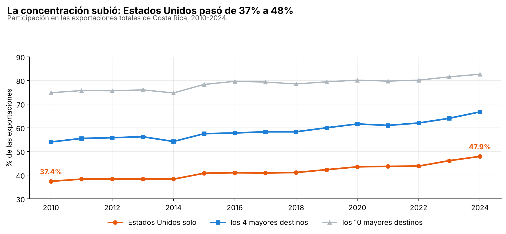
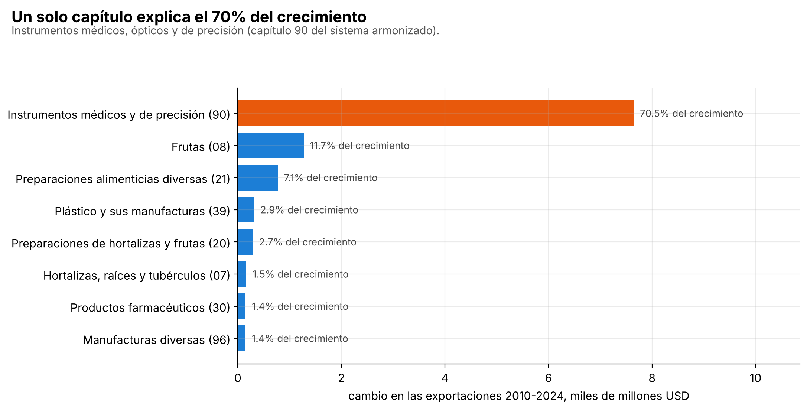
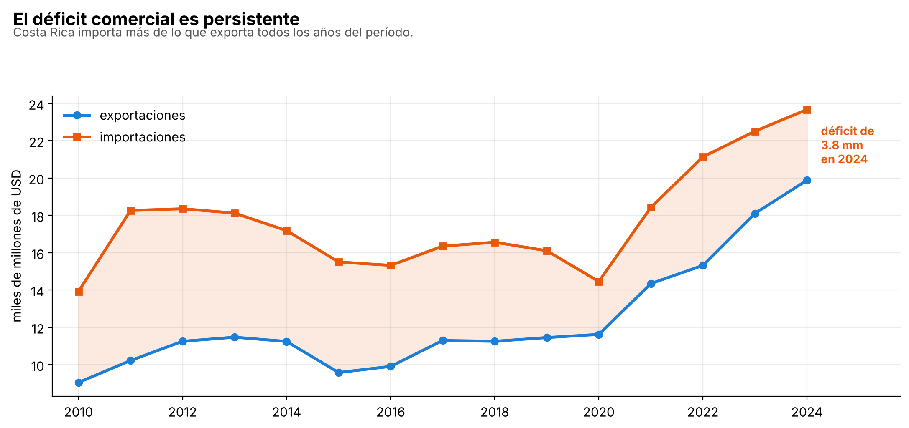

# Costa Rica's foreign trade concentrated instead of diversifying

*[Versión en español](README.md)* ·
**[Interactive dashboard →](https://pabloguerrerocr.github.io/comercio/)** (in Spanish) destinations, products and concentration year by year

**Question.** Costa Rica's goods exports more than doubled between 2010 and 2024. Did
that growth diversify its trade, or concentrate it in fewer destinations and products?

**Short answer.** It concentrated it. In 2024 almost half of what Costa Rica exported
went to the United States, and a single chapter of the Harmonized System, medical
instruments, explains 70% of the growth.

| | 2010 | 2024 |
|---|---:|---:|
| Goods exports | $9.0 bn | **$19.9 bn** |
| Share to the United States | 37.4% | **47.9%** |
| Share to the top 4 destinations | 54.0% | **66.7%** |
| Herfindahl index of destinations | 0.160 | **0.248** |
| Share of medical and precision instruments (chapter 90) | 12.2% | **44.0%** |

## Three findings

**1. More dependence on one country.** The U.S. share rose from 37.4% to 47.9%, and it
was the top destination in all fifteen years. The Herfindahl index of destinations rose
from 0.160 to 0.248: it is as if Costa Rica went from exporting to 6.2 equally sized
destinations to only 4.0. The trend is clear, although it does not rise every year: the
index fell back in 2014 and 2017.



**2. More dependence on one product.** Chapter 90 (medical, optical and precision
instruments) went from $1,100 M to $8,750 M and by itself explains **70.5%** of the
period's export increase, which was $10.8 bn. Its share of exports went from 12% to 44%.
The second largest contributor, fruit, explains 11.7%.



**3. The goods trade deficit is persistent.** Costa Rica imported more goods than it
exported in all fifteen years, with a deficit between $2.8 bn and $8.0 bn. In 2024 it was
$3.8 bn.



## Data

[UN COMTRADE](https://comtradeplus.un.org/), the United Nations trade database: a public
API with no key. Costa Rica is reporter 188. Annual data for 2010-2024, in current
dollars, versioned in `datos/`:

| File | Contents |
|---|---|
| `comercio_por_socio.csv` | total exports and imports by partner |
| `comercio_por_producto.csv` | exports and imports with the world by Harmonized System chapter (2 digits) |

Partner code `0` is the world total and regional aggregates are not countries: adding
them to the countries would count trade twice, so they are excluded from the
concentration measures and from the Power BI model. The chapters add up to each year's
total exports.

What took testing to find out about the API, because the documentation does not make it
clear:

- `partnerCode='all'` returns **HTTP 400**: the parameter has to be omitted.
- The `preview` endpoint cuts off at **500 records** per response, so one year and flow
  combination is requested at a time.
- **It does not return names**: `partnerDesc` and `cmdDesc` come back as `null` and have
  to be joined from the reference catalogs, which are a different endpoint.
- It rate-limits with **HTTP 429**: the downloader backs off progressively and caches
  every response.

## Method

- **Destination concentration:** each country's share of exports, top 1, top 4 and top
  10, and the Herfindahl-Hirschman index (sum of squared shares, from 0 to 1). Its
  inverse is the equivalent number of equally sized destinations.
- **What explains the growth:** each chapter's change between 2010 and 2024 divided by
  the total change in exports.
- **Trade balance:** total exports minus total imports with the world.

## Deliverables for Excel and Power BI users

- **`Comercio_exterior_CR.xlsx`:** the Summary sheet has no pasted values. Every cell is
  a `SUMIFS` or `COUNTIFS` over the data sheets: change the year in the yellow cell and
  everything recalculates. It also includes the concentration series and the chapter
  breakdown, with charts.
- **`04_power_query.m`:** the same ingestion in the M language. Paste it into Excel's
  Advanced Editor and the table refreshes with one click, without Python.
- **`powerbi/`:** a dimensional model (partner, chapter and year dimensions and one fact
  table) and 10 DAX measures: share, Herfindahl, top 4, dependence on the United States
  and year-over-year growth.

## Run it

```bash
git clone https://github.com/pabloguerrerocr/comercio-exterior-cr.git
cd comercio-exterior-cr
pip install -r requirements.txt
python 02_analizar.py   # the findings, on the versioned data
python 03_excel.py      # the Excel workbook
python 05_powerbi.py    # the Power BI model
python 06_figuras.py    # the figures in this README
```

`python 01_bajar.py` downloads the data again from COMTRADE and replaces the files in
`datos/`. Tested with Python 3.13 and pandas 3.1; the Excel workbook was verified by
recalculating it in LibreOffice.

## Limitations

- **Goods only.** Services, where Costa Rica runs a surplus, are not in this data, so the
  goods deficit is not the full external balance.
- **Product and destination are not crossed.** The analysis does not measure how much of
  the medical instruments goes to the United States.
- **These are the figures Costa Rica reports.** Its partners report different ones: the
  difference is the subject of
  [brecha-espejo-cr](https://github.com/pabloguerrerocr/brecha-espejo-cr).
- **COMTRADE revises its figures.** If the data is downloaded again, recent years may
  change.
