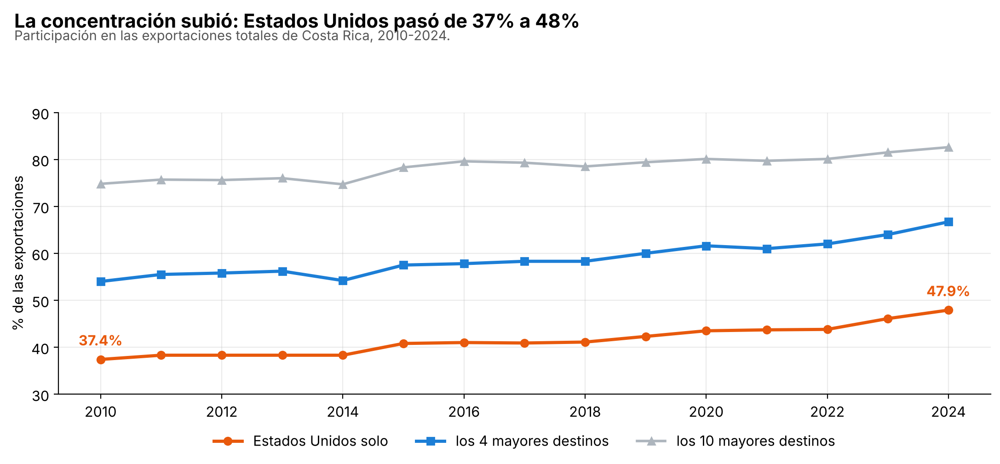
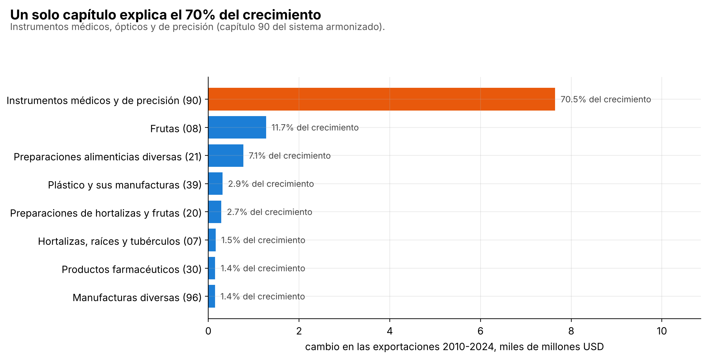
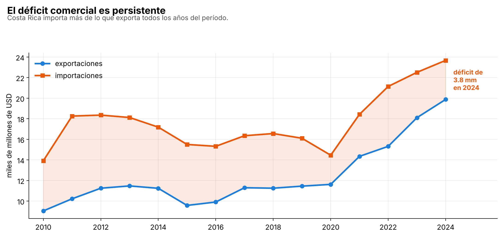

# El comercio exterior de Costa Rica se concentró, no se diversificó

*[English version](README.en.md)* ·
**[Tablero interactivo →](https://pabloguerrerocr.github.io/comercio/)** destinos, productos y concentración año por año

**Pregunta.** Las exportaciones de bienes de Costa Rica más que se duplicaron entre 2010
y 2024. ¿Ese crecimiento diversificó el comercio o lo concentró en menos destinos y
productos?

**Respuesta corta.** Lo concentró. En 2024 casi la mitad de lo exportado fue a Estados
Unidos, y un solo capítulo del sistema armonizado, el de instrumentos médicos, explica
el 70 % del crecimiento.

| | 2010 | 2024 |
|---|---:|---:|
| Exportaciones de bienes | US$9,0 mil millones | **US$19,9 mil millones** |
| Destinado a Estados Unidos | 37,4 % | **47,9 %** |
| Destinado a los 4 mayores destinos | 54,0 % | **66,7 %** |
| Índice Herfindahl de destinos | 0,160 | **0,248** |
| Peso de los instrumentos médicos y de precisión (capítulo 90) | 12,2 % | **44,0 %** |

## Tres hallazgos

**1. Más dependencia de un país.** La participación de Estados Unidos pasó de 37,4 % a
47,9 %, y fue el primer destino los quince años. El índice Herfindahl de destinos subió
de 0,160 a 0,248: es como si Costa Rica pasara de exportar a 6,2 destinos del mismo
tamaño a solo 4,0. La tendencia es clara, aunque no sube todos los años: el índice
retrocedió en 2014 y en 2017.



**2. Más dependencia de un producto.** El capítulo 90 (instrumentos médicos, ópticos y
de precisión) pasó de US$1.100 a US$8.750 millones y explica por sí solo el **70,5 %**
del aumento exportador del período, que fue de US$10,8 mil millones. Pasó de pesar el
12 % de las exportaciones al 44 %. El segundo capítulo que más aporta, el de frutas,
explica el 11,7 %.



**3. El déficit comercial de bienes es persistente.** Costa Rica importó más bienes de
los que exportó los quince años, con un déficit de entre US$2,8 y US$8,0 mil millones.
En 2024 fue de US$3,8 mil millones.



## Datos

[UN COMTRADE](https://comtradeplus.un.org/), la base de comercio de las Naciones Unidas:
API pública y sin llave. Costa Rica es el reporter 188. Datos anuales 2010-2024, en
dólares corrientes, versionados en `datos/`:

| Archivo | Contenido |
|---|---|
| `comercio_por_socio.csv` | exportaciones e importaciones totales por socio |
| `comercio_por_producto.csv` | exportaciones e importaciones con el mundo por capítulo del sistema armonizado (2 dígitos) |

El código de socio `0` es el total mundial y los agregados regionales no son países:
sumarlos junto a los países contaría el comercio dos veces, así que se excluyen de la
concentración y del modelo de Power BI. La suma de los capítulos reproduce el total
exportado de cada año.

Lo que costó averiguar de la API, porque no está claro en la documentación:

- `partnerCode='all'` devuelve **HTTP 400**: hay que omitir el parámetro.
- El endpoint `preview` corta en **500 registros** por respuesta, así que se pide una
  combinación de año y flujo por vez.
- **No devuelve los nombres**: `partnerDesc` y `cmdDesc` vienen en `null` y salen de los
  catálogos de referencia, que son otro endpoint.
- Limita por frecuencia con **HTTP 429**: el bajador espera de forma creciente y cachea
  cada respuesta.

## Método

- **Concentración de destinos:** participación de cada país en las exportaciones, top 1,
  top 4 y top 10, e índice Herfindahl-Hirschman (suma de los cuadrados de las
  participaciones; va de 0 a 1). Su inverso es el número equivalente de destinos del
  mismo tamaño.
- **Qué explica el crecimiento:** el cambio de cada capítulo entre 2010 y 2024 dividido
  entre el cambio total de las exportaciones.
- **Balanza comercial:** exportaciones menos importaciones totales con el mundo.

## Entregables para usuarios de Excel y Power BI

- **`Comercio_exterior_CR.xlsx`:** la hoja Resumen no trae valores pegados. Cada celda es
  un `SUMIFS` o `COUNTIFS` sobre las hojas de datos: se cambia el año en la celda
  amarilla y todo se recalcula. Trae también la serie de concentración y el desglose
  por capítulo, con gráficos.
- **`04_power_query.m`:** la misma ingesta en lenguaje M. Se pega en el Editor avanzado
  de Excel y la tabla se refresca con un botón, sin Python.
- **`powerbi/`:** modelo dimensional (dimensiones de socio, capítulo y año, y una tabla
  de hechos) y 10 medidas DAX: cuota, Herfindahl, top 4, dependencia de Estados Unidos y
  crecimiento interanual.

## Cómo correrlo

```bash
git clone https://github.com/pabloguerrerocr/comercio-exterior-cr.git
cd comercio-exterior-cr
pip install -r requirements.txt
python 02_analizar.py   # los hallazgos, sobre los datos versionados
python 03_excel.py      # el libro de Excel
python 05_powerbi.py    # el modelo para Power BI
python 06_figuras.py    # las figuras de este README
```

`python 01_bajar.py` vuelve a bajar los datos de COMTRADE y reemplaza los de `datos/`.
Probado con Python 3.13 y pandas 3.1; el libro de Excel se verificó recalculándolo en
LibreOffice.

## Limitaciones

- **Solo bienes.** Los servicios, donde Costa Rica tiene superávit, no están en estos
  datos, así que el déficit de bienes no es el saldo externo completo.
- **No se cruza producto con destino.** El análisis no mide cuánto de los instrumentos
  médicos va a Estados Unidos.
- **Son las cifras que reporta Costa Rica.** Los socios declaran otras: la diferencia es
  el tema de [brecha-espejo-cr](https://github.com/pabloguerrerocr/brecha-espejo-cr).
- **COMTRADE revisa sus cifras.** Si se vuelven a bajar los datos, los años recientes
  pueden cambiar.
